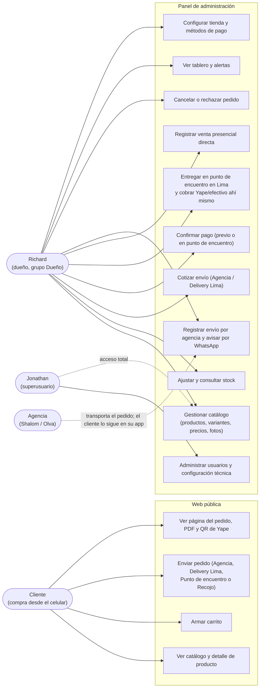

# 00 – Mapa de actores y casos de uso

Quién hace qué en el sistema. Es la vista más general; los demás diagramas bajan al detalle.

## Notas
- El cliente **no se registra**: compra con nombre, teléfono y (si es envío por agencia) DNI.
- En Lima lo más frecuente es que Richard se cite con el cliente en un punto de encuentro, entregue la mercadería y reciba el Yape en ese momento (`A5`).
- Fuentes: `02-reglas-negocio.md` y `03-flujo-pedidos-estados.md`.
