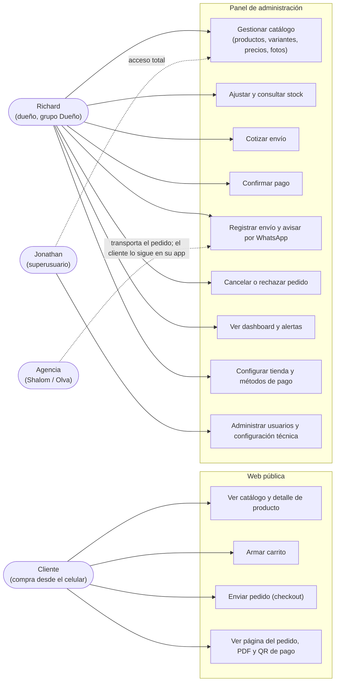

# 00 – Mapa de actores y casos de uso

Quién hace qué en el sistema. Es la vista más general; los demás diagramas bajan al detalle.

## Notas
- El cliente **no se registra**: compra con nombre, DNI y teléfono.
- Richard hace todo lo operativo; Jonathan además ve la configuración técnica.
- Fuentes: `02-reglas-negocio.md` (Roles) y `03-flujo-pedidos-estados.md`.
