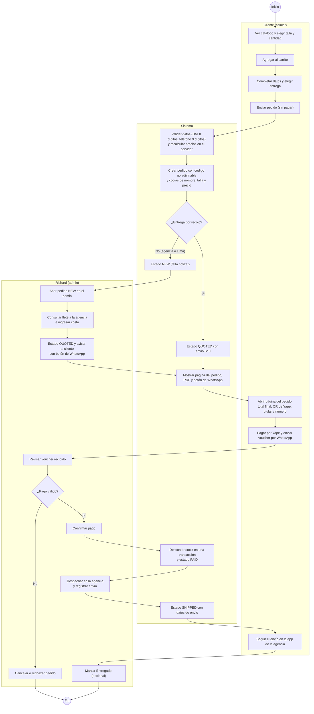

# 01 – Diagrama de actividades: pedido de punta a punta

Calles (swimlanes): Cliente, Sistema, Richard. Entre paréntesis, el estado del pedido. Fuente: `03-flujo-pedidos-estados.md`.

## Notas
- El stock **solo** se descuenta al confirmar el pago (ver `03-actividad-confirmar-pago.md`).
- Si el cliente desconfía de pagar así, sigue por WhatsApp con el PDF del pedido.
- La cotización, el pago y el despacho los registra siempre Richard.
