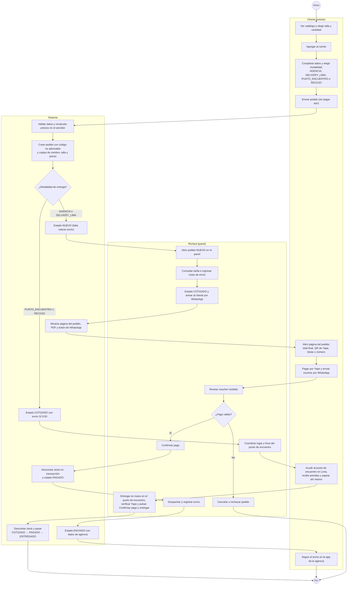

# 01 – Diagrama de actividades: pedido de punta a punta

Calles (swimlanes): Cliente, Sistema, Richard. Contempla tanto el envío a provincia/delivery como la cita en punto de encuentro en Lima (donde el cliente yapea al recibir). Fuente: `03-flujo-pedidos-estados.md`.

## Notas
- El stock **solo** se descuenta cuando Richard confirma el pago (`s7` o `s9`).
- El detalle de la cita en Lima y la venta presencial directa está en `08-actividad-entrega-lima-y-venta-presencial.md`.
