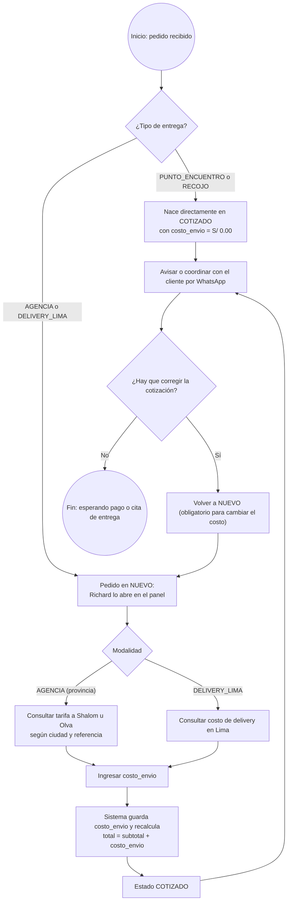

# 02 – Diagrama de actividades: cotizar el envío

El delivery lo paga el cliente y lo cotiza Richard según la agencia o el distrito. Los pedidos de `PUNTO_ENCUENTRO` y `RECOJO` nacen ya en `COTIZADO` con envío `S/ 0.00`.

## Notas
- Cambiar la cotización después de `COTIZADO` obliga a volver a `NUEVO`.
