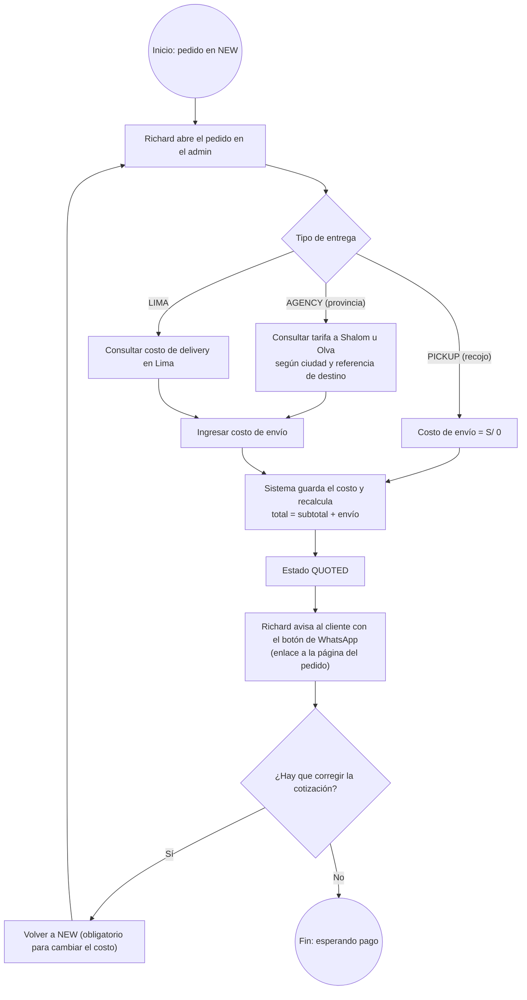

# 02 – Diagrama de actividades: cotizar el envío

El delivery lo paga el cliente y lo cotiza Richard según la agencia y el destino.

## Notas
- Un pedido de recojo nace ya en `QUOTED` con envío S/ 0 y no pasa por este flujo.
- Cambiar la cotización después de `QUOTED` obliga a volver a `NEW`.
