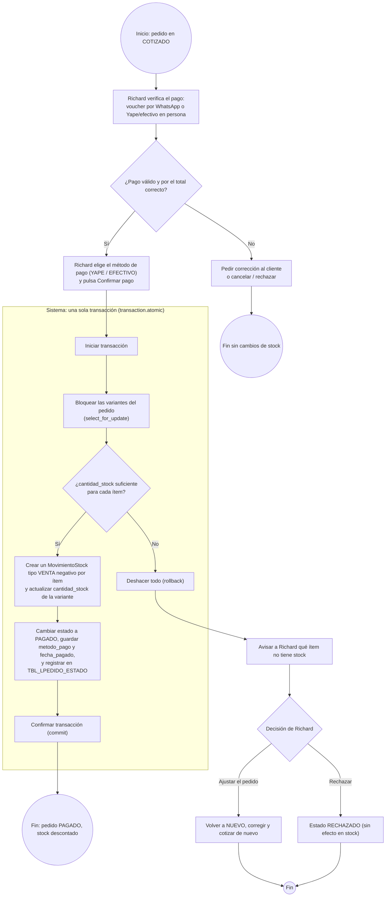

# 03 – Diagrama de actividades: confirmar pago y descontar stock

Es el corazón del negocio. La operación es **atómica**: o se descuenta todo el stock del pedido o nada. La ejecuta `pedidos.servicios.cambiar_estado()`.

## Notas
- El stock nunca se edita a mano: solo cambia por un `MovimientoStock` creado desde un servicio.
- Invariante: `Variante.cantidad_stock` es siempre la suma de sus movimientos y nunca baja de 0.
- En entregas en punto de encuentro en Lima, la acción «Confirmar pago y entregar» ejecuta este bloque y enseguida pasa a `ENTREGADO` en la misma transacción.
