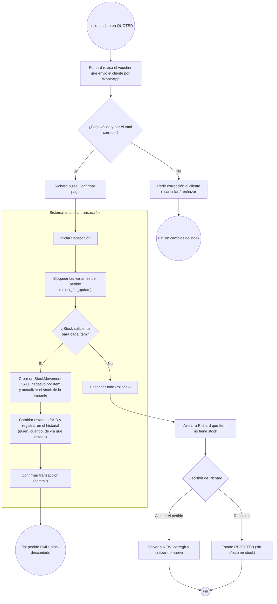

# 03 – Diagrama de actividades: confirmar pago y descontar stock

Es el corazón del negocio. La operación es **atómica**: o se descuenta todo el stock del pedido o nada. La ejecuta `orders.services.change_status()`.

## Notas
- El stock nunca se edita a mano: solo cambia por un `StockMovement` creado desde un service.
- Invariante: `Variant.stock_quantity` es siempre la suma de sus movimientos y nunca baja de 0.
- Si el pago se confirmó, el pedido tiene un movimiento `SALE` por cada ítem.
