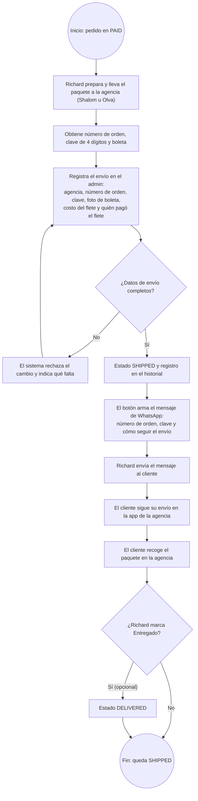

# 04 – Diagrama de actividades: despacho y registro del envío

Richard entrega los paquetes a la agencia y registra el envío. El cliente luego lo sigue en la app de la agencia.

## Notas
- La **clave de recojo** y el **DNI** son datos privados: nunca en URLs, logs ni páginas públicas.
- La foto de la boleta va a un bucket privado.
- Quién pagó el flete es un campo (`CUSTOMER_PREPAID`, `CUSTOMER_AT_DEST`, `RICHARD_ADVANCED`). Si no lo pagó Richard, se marca como informativo.
