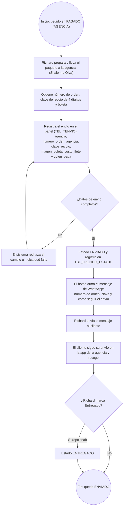

# 04 – Diagrama de actividades: despacho y registro del envío por agencia

Aplica a los pedidos con `tipo_entrega = AGENCIA`. Richard entrega el paquete en Shalom u Olva y registra los datos para el cliente.

## Notas
- La **clave de recojo** y el **DNI** son datos privados: nunca en URLs, logs ni páginas públicas.
- La foto de la boleta va a un bucket privado.
- Quién pagó el flete (`quien_paga`): `CLIENTE_ADELANTADO`, `CLIENTE_EN_DESTINO` o `RICHARD_ADELANTO`.
