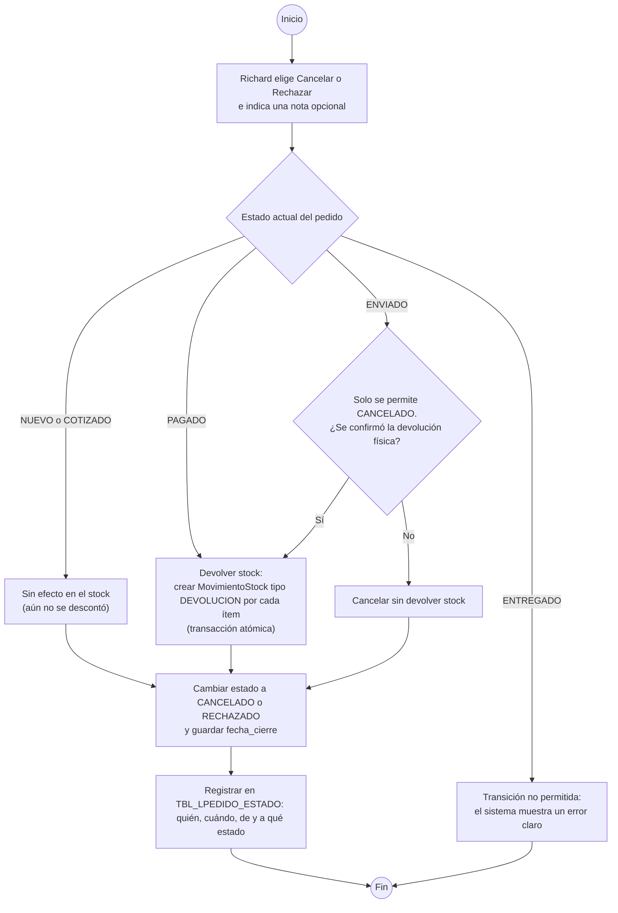

# 05 – Diagrama de actividades: cancelar o rechazar un pedido

Cancelar (`CANCELADO`): el cliente desistió, no pagó o no asistió a la cita. Rechazar (`RECHAZADO`): Richard no acepta el pedido (sin stock, datos inválidos). El efecto sobre el stock depende del estado actual.

## Notas
- `ENVIADO` solo puede ir a `CANCELADO`, no a `RECHAZADO`.
- Toda transición queda en el historial; cualquier otra transición se rechaza con un error claro.
