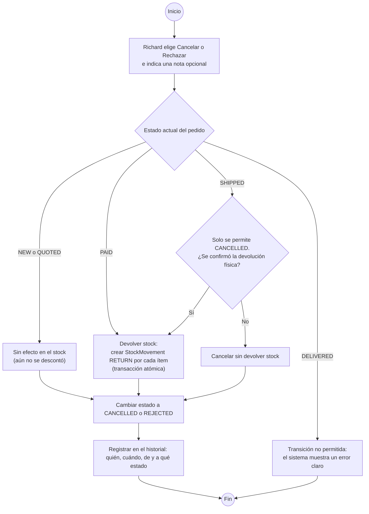

# 05 – Diagrama de actividades: cancelar o rechazar un pedido

Cancelar: el cliente desistió o no pagó. Rechazar: Richard no acepta el pedido (sin stock, datos inválidos). El efecto sobre el stock depende del estado en que está el pedido.

## Notas
- `SHIPPED` solo puede ir a `CANCELLED`, no a `REJECTED`.
- Toda transición queda en el historial; cualquier otra transición se rechaza con un error claro.
