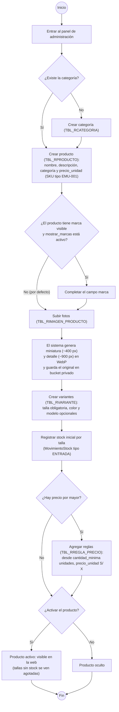

# 06 – Diagrama de actividades: cargar un producto al catálogo

Richard (o Jonathan) carga productos desde el panel de administración. Fuente: `02-reglas-negocio.md`.

## Notas
- El stock inicial se registra con un `MovimientoStock` de tipo `ENTRADA`, no escribiendo el número a mano.
- El catálogo no muestra marcas ni nombres de clubes salvo que el producto lo tenga configurado.
