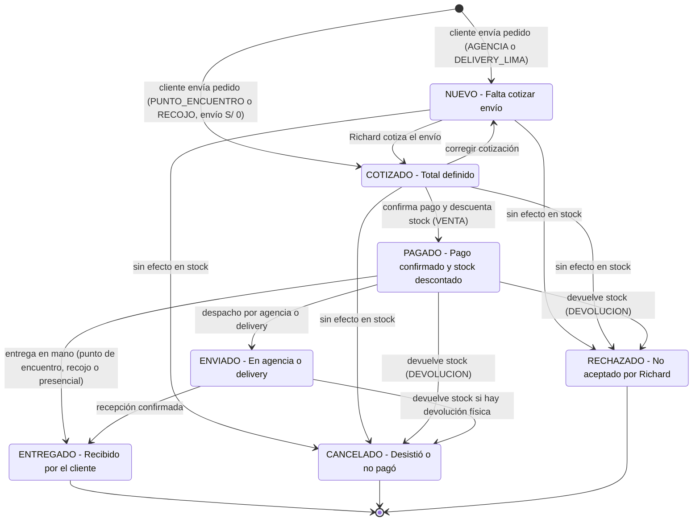

# 07 – Diagrama de estados del pedido

Transiciones permitidas. Cualquier otra se rechaza. Todas las ejecuta `pedidos.servicios.cambiar_estado()` y quedan en `TBL_LPEDIDO_ESTADO`. Fuente: `03-flujo-pedidos-estados.md`.

## Notas
- La acción rápida **«Confirmar pago y entregar»** (para entregas personales en Lima) ejecuta `COTIZADO` → `PAGADO` → `ENTREGADO` dentro de una sola transacción.
- Una venta presencial directa (`origen = PRESENCIAL`) nace y pasa en el mismo acto a `PAGADO` o `ENTREGADO`.
