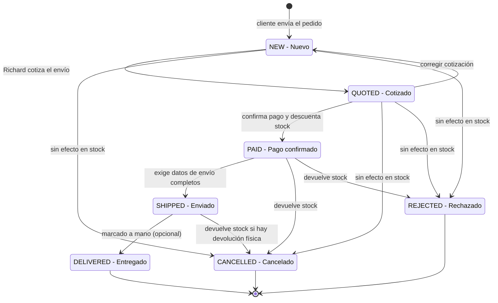

# 07 – Diagrama de estados del pedido

Transiciones permitidas. Cualquier otra se rechaza. Todas las ejecuta `orders.services.change_status()` y quedan en el historial. Fuente: `03-flujo-pedidos-estados.md`.

## Notas
- Un pedido de recojo nace directamente en `QUOTED` con envío S/ 0.
- Un pedido en `PAID` o posterior tiene movimientos `SALE`; en `SHIPPED` tiene un `Shipment` completo.
