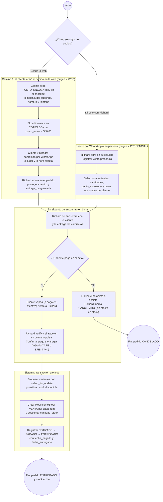

# 08 – Diagrama de actividades: entrega en punto de encuentro en Lima y venta presencial

En Lima lo más habitual es que Richard se cite con el cliente en un lugar acordado, le deje la mercadería y ahí mismo reciba el Yape (o efectivo). Este diagrama cubre los dos caminos posibles.

## Notas
- Si el cliente quiere **asegurar la prenda antes de la cita**, puede yapear por adelantado: Richard confirma el pago (`COTIZADO` → `PAGADO`, ya se descuenta el stock) y cuando se ven en el punto de encuentro solo pulsa «Marcar entregado» (`PAGADO` → `ENTREGADO`).
- Si el cliente cancela después de haber pagado por adelantado, pasar de `PAGADO` a `CANCELADO` devuelve el stock automáticamente con un movimiento `DEVOLUCION`.
