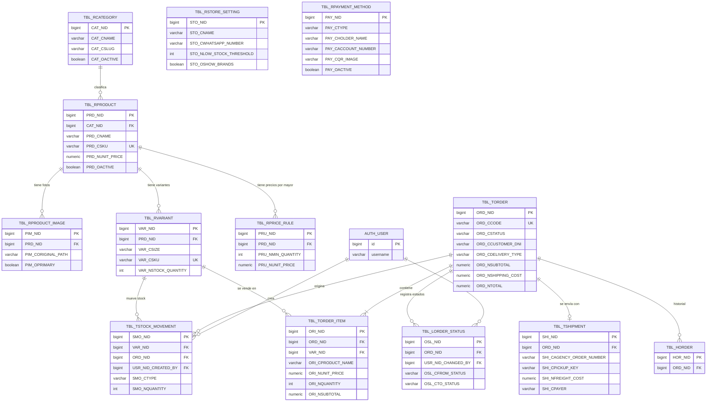

# Modelo Entidad-Relación

Con los nombres físicos del estándar (`../12-estandar-base-datos.md`). Detalle de columnas en `diccionario-datos.md`. `AUTH_USER` es la tabla `auth_user` de Django.

## Notas
- `TBL_RSTORE_SETTING` y `TBL_RPAYMENT_METHOD` no se relacionan con otras tablas.
- `TBL_HORDER` en el diagrama es una simplificación: `django-simple-history` la genera con sus propias columnas (`history_id`, `history_date`…).
- `TBL_TORDER_ITEM` guarda **copias** del nombre, talla y precio; su relación con `TBL_RVARIANT` es protegida, para no perder el vínculo.
