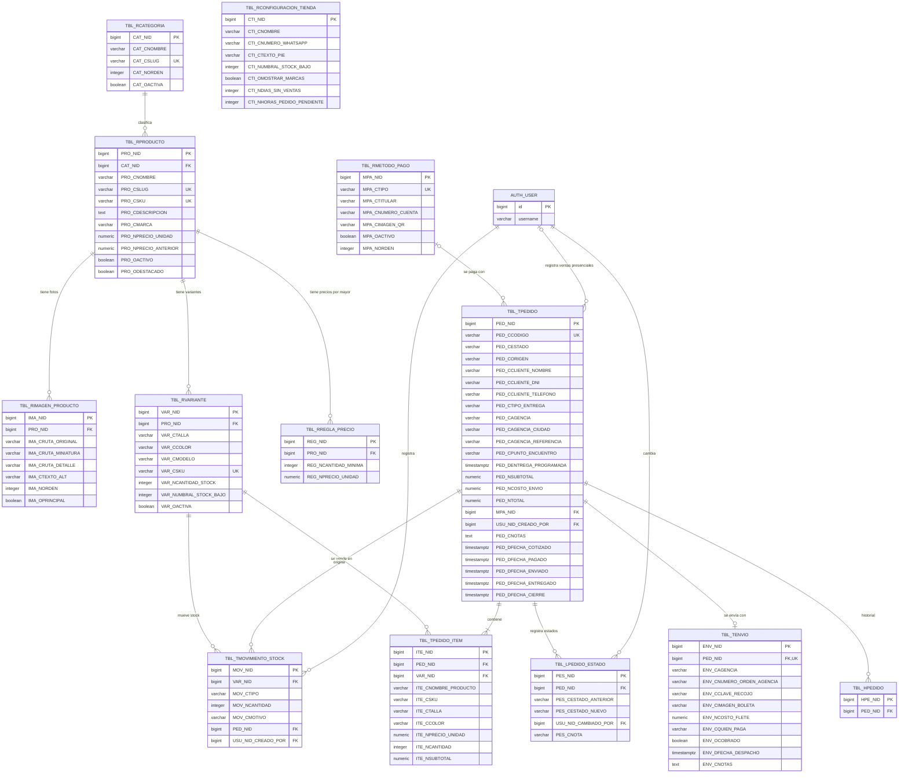

# Modelo Entidad-Relación

> Generado por `generar_diccionario.py`. **No editar a mano.**

Con los nombres físicos del estándar (`../12-estandar-base-datos.md`). Detalle de columnas en `diccionario-datos.md`. `AUTH_USER` es la tabla `auth_user` de Django.

## Notas
- `TBL_HPEDIDO` es una simplificación: `django-simple-history` la genera con sus propias columnas.
- `TBL_TPEDIDO_ITEM` guarda **copias** del nombre, talla y precio; su relación con `TBL_RVARIANTE` es protegida.
- `TBL_TENVIO` existe solo para pedidos con entrega `AGENCIA`.
- `TBL_RCONFIGURACION_TIENDA` no se relaciona con otras tablas.
