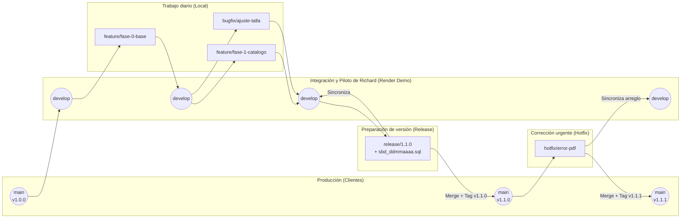

# 14 – Flujo de Git, Ramas y Despliegue DevOps con GitHub

> Versión en Word lista para compartir o imprimir: [`Guia-DevOps-GitHub-Emuna-Sport.docx`](file:///d:/JONATHAN/Proyectos/EcomerceEmunaSport/05-Despliegue/Guia-DevOps-GitHub-Emuna-Sport.docx) (generada con `generar_guia_devops.py`).

Este documento define cómo se organiza el repositorio en **GitHub**, qué significa cada rama, cómo se nombran las versiones y los commits, y cómo pasa un cambio desde tu computadora hasta el piloto de prueba de Richard (`develop`) y a la tienda en producción (`main`).

---

## 1. Mapa de ramas y entornos (GitFlow adaptado)

Trabajamos con **2 ramas permanentes** (`main` y `develop`) y **4 tipos de ramas temporales** (`feature/*`, `bugfix/*`, `release/*`, `hotfix/*`) que se borran una vez fusionadas.

| Rama | Tipo | Nace desde | Se fusiona hacia | Entorno conectado | Para qué sirve |
|---|---|---|---|---|---|
| `main` | Permanente | — | — | **Producción** (Render + Cloudflare) | Código 100% estable que ven los clientes reales. Nunca se programa directo aquí. Cada fusión lleva etiqueta de versión (`v1.1.0`, `v1.2.0`). |
| `develop` | Permanente | `main` | `main` (vía `release/*`) | **Demo / Piloto** (Render Demo) | Rama de integración donde se unen las fases terminadas para que Richard pruebe y dé observaciones. |
| `feature/<nombre>` | Temporal | `develop` | `develop` | Local (computadora de Jonathan) | Desarrollar una fase o funcionalidad nueva (ej. `feature/fase-0-base`, `feature/fase-1-catalogo`, `feature/cita-lima`). |
| `bugfix/<nombre>` | Temporal | `develop` | `develop` | Local | Corregir un error detectado durante el desarrollo o durante las pruebas del piloto en `develop` (ej. `bugfix/calculo-mayorista`). |
| `release/<X.Y.Z>` | Temporal | `develop` | `main` **y** `develop` | Pre-producción | Congelar una entrega lista para salir a producción, generar el script `sbd_ddmmaaaa.sql` y subir el número de versión (ej. `release/1.1.0`). |
| `hotfix/<nombre>` | Temporal | `main` | `main` **y** `develop` | Urgencia en producción | Corregir un fallo crítico en producción sin arrastrar cambios de `develop` que aún no estén listos (ej. `hotfix/error-pdf-pedido`). Sube el tercer número `Z` (`1.1.0` → `1.1.1`). |

---

## 2. Diagrama del ciclo de vida de las ramas



---

## 3. Versionado `X.Y.Z` y etapas

Seguimos el estándar del Área de Desarrollo (`03-Diseno-Tecnico/12-estandar-base-datos.md`):

- **Formato:** `v[X].[Y].[Z]`
  - **`X` (Versión mayor):** cambia cuando se inicia una nueva evolución grande del sistema o rediseño de interfaz. Al subir `X`, `Y` y `Z` vuelven a `0`.
  - **`Y` (Incremento funcional / Fase):** cambia cuando se agregan nuevas funcionalidades o mejoras de módulos/base de datos. Al subir `Y`, `Z` vuelve a `0`.
  - **`Z` (Revisión / Parche / Hotfix):** cambia con cada corrección de errores o mantenimiento (`hotfix/*` o `bugfix/*`).
- **Etapas del proyecto:**
  1. **Alfa (`v0.1.0` a `v0.4.0` en `develop`):** construcción de las Fases 0 a 4.
  2. **Beta / Piloto (`v0.5.0-beta` en `develop`):** desplegado en Render Demo; Richard lo prueba desde su celular y se registran sus observaciones en `06-Observaciones-Piloto/`.
  3. **Estable / Producción (`v1.1.0` en `main`):** primera salida oficial a producción (según el manual de estándares, la primera versión productiva es la **1.1.0**).

---

## 4. Convención de nombres de ramas y mensajes de commit

### 4.1 Nombres de ramas
Todo en minúsculas, sin tildes ni espacios, separado por guiones:
- `feature/fase-0-base`
- `feature/fase-1-catalogo`
- `feature/fase-2-carrito-pedido`
- `feature/fase-3-gestion-pedidos`
- `feature/fase-4-tablero-alertas`
- `bugfix/validacion-dni-agencia`
- `release/1.1.0`
- `hotfix/calculo-total-envio`

### 4.2 Mensajes de commit (en español)
Formato: `<tipo>(<alcance>): <descripción breve en español>`

| Prefijo | Cuándo se usa | Ejemplo |
|---|---|---|
| `feat` | Nueva funcionalidad o pantalla | `feat(pedidos): agregar confirmacion de pago y entrega en cita Lima` |
| `fix` | Corrección de un error (`bugfix` o `hotfix`) | `fix(inventario): bloquear variante con select_for_update al descontar` |
| `docs` | Cambios en documentación, diagramas, diccionario o Swagger | `docs(api): actualizar esquema de venta presencial en openapi.yaml` |
| `refactor` | Mejora interna de código sin cambiar el comportamiento | `refactor(catalogo): mover calculo de precio mayorista a servicios.py` |
| `test` | Nuevas pruebas en `pytest` | `test(pedidos): probar rollback cuando falta stock en una talla` |
| `chore` | Configuración, dependencias, scripts o despliegue | `chore(despliegue): configurar render.yaml y whitenoise` |

---

## 5. Guía práctica de comandos Git (paso a paso)

### Caso 1: Conectar el repositorio remoto por primera vez
Cuando crees el repositorio **privado** vacío en GitHub (sin README ni `.gitignore`, porque ya los tenemos):
```bash
git remote add origin https://github.com/<tu-usuario>/<tu-repo>.git
git push -u origin main
git push -u origin develop
```

### Caso 2: Empezar una nueva fase o funcionalidad (`feature/*`)
Siempre se parte desde `develop` actualizado:
```bash
git checkout develop
git pull origin develop
git checkout -b feature/fase-0-base
```
Mientras trabajas, guardas avances y subes tu rama:
```bash
git add -A
git commit -m "feat(nucleo): crear ConfiguracionTienda y MetodoPago con estandar TBL_"
git push -u origin feature/fase-0-base
```

### Caso 3: Terminar la funcionalidad y pasarla a `develop` (Piloto)
1. Antes de fusionar, verifica que todo pase en local:
   ```bash
   ruff check .
   pytest
   python 03-Diseno-Tecnico/base-datos/generar_diccionario.py
   ```
2. Abre un **Pull Request (PR)** en GitHub de `feature/fase-0-base` → `develop` (o haz merge local si trabajas solo):
   ```bash
   git checkout develop
   git pull origin develop
   git merge --no-ff feature/fase-0-base -m "Merge feature/fase-0-base hacia develop"
   git push origin develop
   git branch -d feature/fase-0-base
   ```
3. Al subir a `develop`, **Render Demo** despliega automáticamente el piloto para que Richard lo vea.

### Caso 4: Corregir una observación del piloto (`bugfix/*`)
```bash
git checkout develop
git pull origin develop
git checkout -b bugfix/ajuste-mensaje-whatsapp
# ... haces la corrección y pruebas ...
git add -A
git commit -m "fix(pedidos): incluir punto de encuentro en texto de WhatsApp"
git checkout develop
git merge --no-ff bugfix/ajuste-mensaje-whatsapp -m "Merge bugfix/ajuste-mensaje-whatsapp hacia develop"
git push origin develop
git branch -d bugfix/ajuste-mensaje-whatsapp
```

### Caso 5: Publicar una versión en Producción (`release/*` → `main`)
Cuando `develop` ya fue probado por Richard y está listo para producción:
```bash
git checkout develop
git pull origin develop
git checkout -b release/1.1.0

# 1. Guardar el script completo de esquema en 03-Diseno-Tecnico/base-datos/scripts-bd/sbd_ddmmaaaa.sql
# 2. Actualizar 00-Gestion/11-decisiones-cambios.md y ESTADO-ACTUAL.md
git add -A
git commit -m "chore(release): preparar version 1.1.0 para produccion"

# 3. Fusionar hacia main y etiquetar la versión
git checkout main
git pull origin main
git merge --no-ff release/1.1.0 -m "Release v1.1.0 a produccion"
git tag -a v1.1.0 -m "Version 1.1.0 - Salida inicial a produccion"
git push origin main --tags

# 4. Devolver los ajustes de release hacia develop y borrar la rama temporal
git checkout develop
git merge --no-ff release/1.1.0 -m "Sincronizar release/1.1.0 en develop"
git push origin develop
git branch -d release/1.1.0
```

### Caso 6: Corregir un fallo urgente en Producción (`hotfix/*`)
Si aparece un error en la tienda real (`main`) y no puedes esperar a lo que hay en `develop`:
```bash
git checkout main
git pull origin main
git checkout -b hotfix/error-descarga-pdf

# ... corriges el error y ejecutas pytest ...
git add -A
git commit -m "fix(pedidos): corregir codificacion de tildes al generar PDF"

# 1. Pasar el arreglo a main y subir Z (v1.1.1)
git checkout main
git merge --no-ff hotfix/error-descarga-pdf -m "Hotfix v1.1.1: corregir generacion de PDF"
git tag -a v1.1.1 -m "Version 1.1.1 - Correccion urgente de PDF"
git push origin main --tags

# 2. Pasar el mismo arreglo a develop para que no se pierda
git checkout develop
git merge --no-ff hotfix/error-descarga-pdf -m "Sincronizar hotfix v1.1.1 en develop"
git push origin develop
git branch -d hotfix/error-descarga-pdf
```

---

## 6. Automatización DevOps (CI/CD con GitHub Actions y Render)

### 6.1 Integración Continua (GitHub Actions en cada Push / Pull Request)
En la Fase 0 se configura `.github/workflows/ci.yml` para que en cada subida a `feature/*`, `develop` o `main` se ejecute automáticamente:
1. **Lint y formato:** `ruff check .` y `ruff format --check .`.
2. **Estándar de Base de Datos:** `python 03-Diseno-Tecnico/base-datos/generar_diccionario.py` (verifica que ninguna tabla o columna rompa el estándar `TBL_`).
3. **Contrato OpenAPI/Swagger:** validación de `03-Diseno-Tecnico/api/openapi.yaml`.
4. **Pruebas automatizadas:** `pytest` (incluyendo pruebas de transacciones de stock, estados de pedido y docstrings).

Si alguno de los 4 pasos falla, GitHub bloquea la fusión a `develop` o `main`.

### 6.2 Despliegue Continuo (CD en Render)
| Entorno | Rama que escucha | Base de datos | Qué ejecuta al desplegar |
|---|---|---|---|
| **Local** | `feature/*` / `bugfix/*` | SQLite | `python manage.py migrate` + `pytest` |
| **Demo (Piloto Richard)** | `develop` | PostgreSQL Demo / SQLite con semilla | `pip install` → `collectstatic` → `migrate` → `cargar_demo` → `gunicorn` |
| **Producción** | `main` | PostgreSQL persistente (con respaldos) | `pip install` → `collectstatic` → `migrate` → `gunicorn` (nunca corre `cargar_demo`) |

---

## 7. Reglas de oro de seguridad y control en GitHub
1. **Repositorio PRIVADO:** contiene manuales y lógica interna del negocio.
2. **Protección de ramas (`Branch Protection` en GitHub):**
   - Proteger `main` y `develop` para impedir `git push --force` y borrado accidental.
   - Exigir que las pruebas de GitHub Actions estén en verde antes de fusionar.
3. **Prohibido subir secretos o datos reales:** `.env`, el QR de Yape, fotos de boletas de Shalom/Olva y DNI de clientes reales están bloqueados en `.gitignore` y solo se configuran por variables de entorno o desde el panel de administración.
4. **Memoria de la IA:** antes de cerrar cualquier rama `feature/*` o `bugfix/*`, actualizar `00-Gestion/ESTADO-ACTUAL.md` y `00-Gestion/BITACORA-sesiones.md` en el último commit de la rama.
